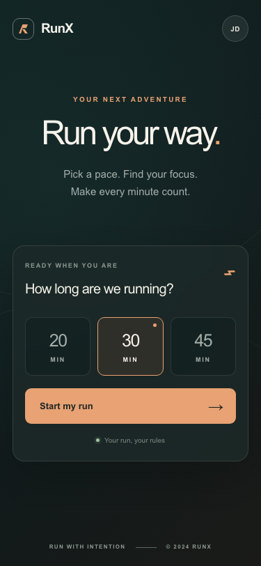

# HW3 before/after comparison: the same feature with and without AGENTS.md

Feature: GitHub issue #6, "Build Home screen with duration picker" (Sprint 1, story US-2). Tool: VS Code Copilot chat in Agent mode, same model in both runs (model name: _add the name shown in the chat model picker_).

## 1. Method

| | Without rules | With rules |
|---|---|---|
| Branch | `experiment/no-rules` | `feature/6-home-duration-picker` |
| Base commit | `6fce4a3` (main after the scaffold) | `6fce4a3` |
| Removed | `AGENTS.md`, `CLAUDE.md`, `DESIGN.md`, all of `docs/` (PRD, feature PRDs, design, tokens), PR and issue templates, process text in `README.md`, the script that held the issue text | nothing |
| Environment | fresh clone in a new VS Code window, empty chat history | normal workspace |
| Prompt | "Build the home screen of a running app where the user picks a 20, 30 or 45 minute run and taps Start. Include tests." | "Implement GitHub issue #6 (Build Home screen with duration picker). Follow AGENTS.md; read the issue's acceptance criteria, DESIGN.md and docs/design/ first." |
| Result committed | `0706cef`, unmodified | `6818c57`, unmodified |

Nobody edited the generated code. One run per condition, so the numbers are indicative, not statistical (see section 6).

## 2. Results

| Measure | Without rules | With rules |
|---|---|---|
| Replies start with the 🏃 marker (proof the rules file was read) | No | Yes, every reply |
| Reads PRD, DESIGN.md, tokens and the issue before coding | No: read only the scaffold | Yes: issue via `gh`, DESIGN.md, `docs/design/README.md`, `tokens.css` |
| Hardcoded hex colors in the CSS | 25 | 4 |
| `rgba()`/`hsl()` color literals | 13 | 5 |
| Uses of design tokens (`var(--...)`) | 4 (its own variables) | 76 (DESIGN.md tokens) |
| Font | Arial | `--font-ui` from DESIGN.md |
| UI structure | all 111 lines in `src/app/page.tsx`, no component | `page.tsx` is 5 lines, `HomeScreen` in `src/components/` |
| Touch targets below 44 px | 1 (38 px profile button) | 0 (`--tap` 44 px) |
| Issue #6 required criteria met (3: chips and Start, layout matches design, targets and names) | 1 of 3 | 3 of 3 |
| Optional criterion: custom duration 15-60, steps of 5 | not built | built |
| Finish time shown (DESIGN.md rule) | No | Yes |
| Controls that do nothing | 1 (profile "JD"; Start only flips a label) | 1 (world toggle, which AGENTS.md said not to build) |
| Tests written / passing | 2 / 2 | 3 / 3 |
| Test queries by role and label | yes | yes |
| Start button clicked in a test | yes | no (only checked that it renders) |
| E2E spec kept in sync | updated and passing | not updated: it still expects the old "RunX" heading and would fail |
| New dependencies | 0 | 0 |
| `npm run build` | pass | pass |
| Branch named by convention | not applicable | yes |
| Failing test committed first (TDD) | no | no |

AGENTS.md rule audit (14 checks: thin page, component file naming, logic outside components, tokens not hex, design font, touch targets, accessible names, default 30, finish time, no useless controls, one test file per module, Start clicked in a test, TDD order, no new dependencies): the no-rules run breaks **9** of 14 (several only because it never saw the rules), the with-rules run breaks **7**. The gap is small by count and large in kind, as the next sections show.

## 3. Visual comparison (375 px)

| Without rules | With rules |
|---|---|
|  |  |

Without rules the AI produced a competent but generic running app (dark theme, "Run your way.", a "JD" profile button, a 2024 footer) with no story, no characters and none of the design system. With rules it produced the RunX home screen as designed: Don Quixote and Sancho, the "You" marker, the episode card, the length chips with 30 selected, the finish time, and the "pocket your phone" hint.

## 4. Differences by dimension

**Code quality and consistency with project patterns.** Without rules everything sits in one default-exported page. With rules the page is a thin wrapper and the feature lives in `src/components/home-screen.tsx` with a named export, constants in `UPPER_SNAKE`, and minutes only at the UI boundary, as AGENTS.md prescribes. The with-rules component still holds validation logic that belongs in `src/lib/`.

**Understanding of the design and mockup intent.** This is the largest gap. Only the with-rules run read DESIGN.md and the tokens, and only it produced the two-character stage, the glass card and the finish-time line. The no-rules run could not know the product is a story app, because the one-sentence brief said "a running app".

**Adherence to naming conventions and architecture.** The with-rules run followed the architecture split and token usage but broke two naming rules (component file `home-screen.tsx` instead of `HomeScreen.tsx`; tests added to `smoke.test.tsx` instead of a new per-module file). Without rules there was no structure to follow.

**Quality of tests.** Similar size and style in both (Testing Library, queries by role). Without rules the tests exercised the Start action and the E2E spec was kept in sync; with rules the tests covered the default selection, switching and the custom duration, but not a click on Start, and the E2E spec was left stale. Rules improved *what* is built far more than they improved *how well it is tested*.

## 5. What rules did not fix (inputs to AGENTS.md v2)
1. Built a non-functional world-toggle button although the scope rule said not to.
2. Business logic (custom-duration validation) written twice inside the component.
3. Component file name in kebab-case; the rule's two clauses on one line were ambiguous.
4. New tests appended to the smoke test file; Start never clicked; E2E spec stale.
5. No TDD order and nothing committed (both runs).
6. Four hex colors and five `rgba()` values still hardcoded.
7. The installed stack differs from the version table (TypeScript 5 and ESLint 9, not 7 and 10).

Changes made for each point are in [changelog.md](changelog.md).

## 6. Threats to validity
- One run per condition; a model can vary between runs.
- The with-rules run happened after a read-only attempt in the same window; it only added reading, and the rules were meant to be read anyway.
- The no-rules condition is deliberately stricter than "delete AGENTS.md": see the contaminated attempt below.
- Counts of rule breaks were audited by hand against AGENTS.md.
- v2 of the rules has not been re-tested yet; the improvement from v1 to v2 is not measured.

## 7. Extra evidence: the harness and context leakage
A first no-rules attempt, made in the same VS Code window as the with-rules run, was **contaminated**. On a branch that had no AGENTS.md, every reply still began with 🏃, the agent first searched for `docs/PRD.md`, `DESIGN.md` and `tokens.css`, it opened an attachment from the earlier chat (`file_home-screen.tsx`), it announced it would avoid "custom durations and world switching", and its copy ("Ride into a story.", "Giants on the Horizon") matched DESIGN.md. Two things follow: the 🏃 marker is a reliable test for whether the tool loaded the rules file, and a "no rules" condition needs a fresh clone, a new window and an empty chat history, because session history and attachments carry rules across chats. That output is kept on `experiment/no-rules-contaminated` and not used in the numbers above. A first with-rules attempt ran in a read-only agent mode and changed nothing; it still showed the 🏃 marker and the reading order from AGENTS.md section 3.

## 8. Evidence index
- Branches: `experiment/no-rules`, `feature/6-home-duration-picker`, `experiment/no-rules-contaminated`.
- Screenshots: `docs/hw3/screenshots/`.
- Rules file before this change: AGENTS.md at `6fce4a3`; after: this pull request.
